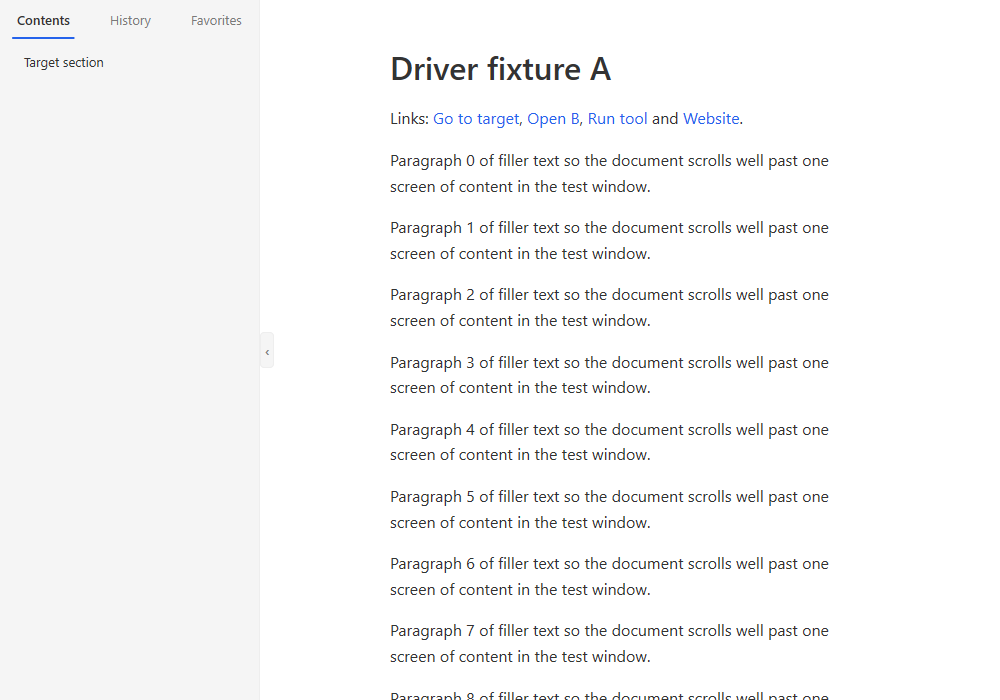

# YAMDV — Yet Another Markdown Viewer

A native Windows Markdown viewer and editor written from scratch in Rust. Reading first, fully
offline, small (one `yamdv.exe`, a few MiB of working set), no runtime, no installer framework.



**Version 1.0.0.** CommonMark + GFM (tables, task lists, footnotes, callouts, `<details>`),
30 code lexers, native math and Mermaid (flowchart, sequence), local images, 11 color schemes
with light/dark mode, English and Turkish UI.

## Install, portable use, uninstall

- **Install for the current user (no admin):** run `yamdv.exe --install`, or start `yamdv.exe`
  and click **Install YAMDV for this user** on the welcome page. It copies itself to
  `%LOCALAPPDATA%\Programs\YAMDV\`, registers the Markdown file types, adds a Start-menu
  shortcut and an *Apps & features* entry, then starts the installed copy. Click
  **Set as default** on its welcome page; Windows Settings opens so you choose YAMDV yourself.
  Running `--install` again is safe (it refreshes the same files and keys).
- **Portable:** put an empty file named `yamdv.portable` next to `yamdv.exe`. Settings,
  history and favorites then live in `YAMDV-data\` beside the exe and nothing is registered.
- **Uninstall:** *Settings ▸ Apps ▸ YAMDV ▸ Uninstall*, or `yamdv.exe --uninstall`. A dialog
  asks whether to keep your settings; the registry values, the shortcut and the install folder
  are removed (exactly what `--install` wrote).

## Reading and editing

| Key | What it does |
|---|---|
| `F2` | **Live Edit**: edit the block under the caret in place; the rest stays rendered |
| `F3` | **Split Edit**: source on one side, live preview on the other |
| `F4`, `Ctrl+E` | open the file in your external editor (VS Code, Notepad++, Notepad, or a custom command) |
| right-click, `Shift+F10` | context menu: copy, appearance, file, export, settings |

Other shortcuts: `Ctrl+O` open · `F5` reload · `Ctrl+F` find (`Ctrl+G` / `Ctrl+Shift+G`) ·
`Ctrl+\` outline · `Ctrl+D` favorite · `Ctrl+C` / `Ctrl+Shift+C` copy / copy as Markdown ·
`Ctrl+=` / `Ctrl+-` / `Ctrl+0` font size · `Alt+↑` / `Alt+↓` column width · `Alt+←` / `Alt+→`
back / forward · `Ctrl+S` save (edit modes) · `Ctrl+P` print · `Ctrl+Shift+E` export PDF ·
`F1` all shortcuts · `Esc`, `Ctrl+W` close.

## Export and print

- **Export ▸ Export HTML…** writes one self-contained `.html`: the current color scheme as
  inline CSS, a table of contents, highlighted code, and images, formulas and diagrams embedded
  as `data:` URIs. It contains no script and carries a strict Content-Security-Policy.
- **Export ▸ Export PDF…** (`Ctrl+Shift+E`) prints through *Microsoft Print to PDF*;
  **Print…** (`Ctrl+P`) uses any printer. Pages break between blocks or lines; table rows,
  code lines and diagrams are never split.
- Right-click a table: **Copy table as CSV** / **Export table as CSV…** (UTF-8 with BOM, CRLF,
  RFC 4180; cells starting with `= + - @` or a tab are prefixed with `'` so spreadsheets do not
  run them as formulas).
- Headless: `yamdv --export-html in.md [-o out.html] [--theme github] [--mode light|dark]`,
  `yamdv --export-pdf in.md [-o out.pdf]`. Exit codes: 0 ok, 1 error, 2 usage.

## Privacy, and how to check it

YAMDV contains no networking code. It never downloads anything a document points to (remote
images show a placeholder), sends no telemetry and uploads no crash reports. Settings stay in
`%APPDATA%\YAMDV` (or `YAMDV-data` in portable mode). To check this yourself:

1. Block `yamdv.exe` in Windows Firewall (outbound). Nothing changes.
2. Open a document with remote images. While it is open, `netstat -ano` and Resource Monitor
   show no connection owned by `yamdv.exe`.
3. `cargo xtask check-imports yamdv.exe` lists the imported DLLs. No `ws2_32`, `winhttp`,
   `wininet`, `urlmon` or similar appear; CI runs this on every build.

Links open only when you click them, after a confirmation, in your default browser.

## Known limitations

v1 is complete, but some features are planned for later. They are listed in
[`docs/FUTURE.md`](docs/FUTURE.md) and tracked as issues labeled `future` in milestone
[`post-v1`](https://github.com/abuzer1495/YAMDV/milestone/1).
Examples: PDF text is a raster image, not selectable (FUT-39); the HTML export is static
(FUT-21); only Mermaid flowchart and sequence diagrams are supported (FUT-18); SVG, WebP and ICO
images show a placeholder (FUT-20, FUT-48); there is no settings panel (settings are in the
context menu and in `settings.ini`, FUT-31).

## Build from source

Requires Windows 10/11 x64 and the Rust toolchain pinned in `rust-toolchain.toml` (1.99.0,
MSVC target).

```
cargo build --release --locked -p yamdv-app      # target\release\yamdv.exe
cargo test --workspace --locked
cargo xtask ci                                   # fmt, clippy, tests, spec checks
```

Documentation: [`docs/SPEC.md`](docs/SPEC.md), [`docs/ARCHITECTURE.md`](docs/ARCHITECTURE.md),
[`docs/SECURITY.md`](docs/SECURITY.md), [`docs/PROCESS.md`](docs/PROCESS.md),
[`CHANGELOG.md`](CHANGELOG.md).

## License

License: to be decided (see issue [DEC-01](https://github.com/abuzer1495/YAMDV/issues/71)).
Until then [`LICENSE`](LICENSE) is a placeholder: all rights reserved.

## Türkçe

YAMDV, Windows için Rust ile sıfırdan yazılmış, çevrimdışı çalışan küçük bir Markdown
görüntüleyici ve düzenleyicidir. **Kurulum:** `yamdv.exe --install` komutunu çalıştırın
(yönetici izni gerekmez) ya da karşılama sayfasındaki **YAMDV'yi bu kullanıcı için yükle**
düğmesine tıklayın. **Taşınabilir kullanım:** exe dosyasının yanına `yamdv.portable` adlı boş
bir dosya koyun. **Kaldırma:** *Ayarlar ▸ Uygulamalar ▸ YAMDV* veya `yamdv.exe --uninstall`.
`F2` Canlı Düzenleme, `F3` Bölünmüş Düzenleme, `F4` harici düzenleyici açar. Sağ tık menüsünde
HTML/PDF dışa aktarma, yazdırma ve tabloyu CSV olarak kopyalama bulunur. YAMDV ağ bağlantısı
kurmaz ve telemetri göndermez. Arayüz Türkçe ve İngilizcedir; dil, bağlam menüsündeki
*Ayarlar ▸ Dil* bölümünden değiştirilir. Lisans: henüz belirlenmedi (bkz. DEC-01).
